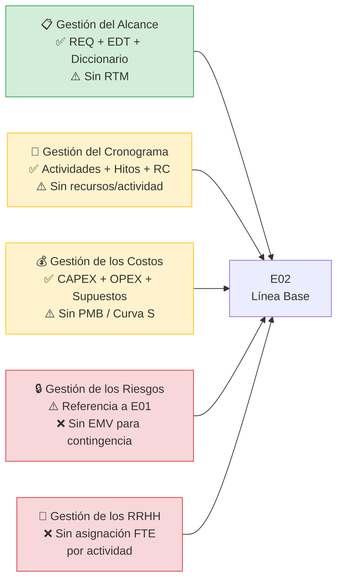

# Análisis PMBOK del Entregable E02 — Línea Base de Alcance, Cronograma y Costo
### Agente Financiero Personal · Banca Personas BCP · MGT209

---

> [!NOTE]
> Este análisis toma como referencia la **Guía del PMBOK 7.ª edición (PMI, 2021)** y los procesos del **Grupo de Procesos de Planificación** de la 6.ª edición (aún vigente operativamente). Se estructura en cuatro dimensiones: fortalezas, brechas críticas, recomendaciones de mejora y guía para la exposición oral.

---

## 1. 🏆 Fortalezas del documento (lo que está bien)

### 1.1 Alcance — Requisitos MoSCoW (§1)

| Aspecto | Calificación |
|---|---|
| Uso correcto de MoSCoW (Must/Should/Could/Won't) | ✅ Excelente |
| 22 requisitos con ID, categoría, perfil y criterio de aceptación | ✅ Excelente |
| "Won't Have" explícitos (REQ-19 a REQ-22) | ✅ Muy bien — pocos equipos documentan el **fuera de alcance** |
| Criterios de aceptación verificables por prueba | ✅ Bien |
| Alineación con normativa SBS (REQ-03, REQ-09, REQ-10) | ✅ Excelente |

**Insight PMBOK:** El Proceso *5.2 Recopilar Requisitos* recomienda incluir criterios de aceptación para cada requisito. Este documento lo cumple con solvencia.

### 1.2 EDT/WBS (§2)

- 5 componentes de primer nivel bien definidos y coherentes con el Charter (E01).
- Diccionario de paquetes completo: descripción, entradas, salidas y criterio de aceptación para cada paquete hoja.
- **Código de paquetes numérico** (1.1, 2.1, 3.3…) permite trazabilidad directa al cronograma y al presupuesto — esto es justo lo que el PMBOK exige en *5.4 Crear la EDT*.
- El paquete 4.3 (Yape) está correctamente aislado con holgura total, protegiéndose de que un descubrimiento de alto riesgo bloquee la ruta crítica.

### 1.3 Cronograma (§3)

- **Ruta crítica identificada** con 17 actividades (A01→A32) y justificación narrativa de por qué A07/A08/A09 no son críticas.
- Dependencias FS documentadas; se indica el caso especial FS+4 para A30 (Yape).
- Hitos H0–H6 coinciden con el Charter: **consistencia inter-entregable**, criterio de auditoría PMBOK.
- El Gantt con colores diferenciados (ruta crítica, actividades normales, holgura, actividad continua) es adecuado para una audiencia ejecutiva.

### 1.4 Presupuesto (§4)

- CAPEX y OPEX separados correctamente.
- 12 supuestos documentados y numerados — cumple *7.1 Planificar la Gestión de los Costos*.
- Contingencia (10%) y reserva de gestión (5%) distinguidas correctamente: **muy pocos entregables de clase universitaria hacen esta distinción**.
- Indicadores VAN, TIR, payback y ROI referenciados al E01 con advertencia de sensibilidad.
- TCO a 5 años incluido.

### 1.5 Trazabilidad EDT → Plazo → Costo (§5)

- La tabla final cierra el ciclo: cada componente tiene responsable, hito, semana y costo.
- La suma cuadra exactamente con el E01. Esto satisface el **criterio de revisión** del instructions.md.

---

## 2. ⚠️ Brechas y críticas (lo que falta o debe mejorar)

### 2.1 🔴 CRÍTICO — Sin Diccionario de Requisitos cruzado con la EDT

El documento tiene una tabla de requisitos (§1) y una tabla EDT (§2), pero **no hay una matriz de trazabilidad explícita** que relacione REQ-XX con el paquete WBS que lo implementa.

| Brecha | Proceso PMBOK afectado |
|---|---|
| ¿Qué paquete WBS implementa REQ-04 (simulación de crédito)? | *5.3 Definir el Alcance* → Rastreabilidad de requisitos |
| ¿Todos los Must Have tienen al menos un paquete hoja asignado? | *5.4 Crear la EDT* |

**Recomendación:** Agregar una **Matriz de Trazabilidad de Requisitos (RTM)** con columnas: `REQ-ID | Prioridad MoSCoW | Paquete WBS | Hito | Estado`. El PMBOK la menciona como salida clave del proceso 5.2.

---

### 2.2 🔴 CRÍTICO — Sin estimación de recursos por actividad

El cronograma define duraciones en semanas pero **no especifica cuántas personas/perfiles se asignan a cada actividad**. PMBOK exige:

- Proceso *9.2 Estimar los Recursos de las Actividades*
- El costo de USD 480,000 para "Vista de posición y datos" es creíble, pero sin saber si es 2 ingenieros × 16 semanas o 4 ingenieros × 8 semanas, **el plan no es auditable**.

**Recomendación:** Agregar al menos una columna `Recursos estimados (FTE)` a la tabla de actividades, o una tabla separada de asignación de recursos por actividad.

---

### 2.3 🟡 MODERADO — La ruta crítica en el Gantt no coincide exactamente con la tabla de actividades

En el Gantt, **H3 se pone en la semana 24 pero A17 (Piloto UAT) termina en las semanas 25–26**. Si H3 es el hito del piloto, debería estar en la semana 26, no en la 24. Esta inconsistencia puede confundir al evaluador.

Verificación rápida:
```
A14 (Perfil Consulta) → sem 22-23
A15 (Móvil-Consulta)  → sem 24-26
A16 (Web-Consulta)    → sem 24-26
A17 (Piloto UAT)      → sem 25-26
H3 está en sem 24 en el Gantt ← inconsistencia
```

**Recomendación:** Mover H3 a la semana 26 en el Gantt, o clarificar que H3 es el inicio del piloto (semana 24), no su cierre.

---

### 2.4 🟡 MODERADO — La contingencia del 10% no tiene un registro de riesgos asociado

Se menciona que la contingencia "cubre principalmente el componente 2", pero sin una tabla de riesgos cuantificados que justifique ese 10%.

**PMBOK 6.ª ed., Proceso 11.5** (*Planificar la Respuesta a los Riesgos*) exige que la reserva de contingencia se derive de la valoración del riesgo (EMV o simulación).

**Recomendación:** Incluir una mini-tabla de los 3–5 riesgos principales con probabilidad, impacto y EMV acumulado ≈ USD 142,000.

---

### 2.5 🟡 MODERADO — Sin línea base de medición del desempeño (PMB)

El PMBOK 7 menciona explícitamente la **Performance Measurement Baseline (PMB)** como la integración de alcance, cronograma y costo con curva S de gasto planificado.

Actualmente el documento solo lista el CAPEX por componente, pero no hay:
- Distribución temporal del gasto (¿cuánto se gasta en cada mes?)
- Curva S que permita calcular EV (Earned Value) en la ejecución

**Recomendación:** Agregar una tabla de **distribución mensual del CAPEX** (aunque sea aproximada por hitos) y una curva S básica.

---

### 2.6 🟢 MENOR — El Gantt no muestra las dependencias entre barras

Las flechas de dependencia (FS) no se dibujan en el Gantt con `pgfgantt`, lo que hace más difícil validar la ruta crítica visualmente.

**Recomendación:** Usar `\ganttlink` de pgfgantt para las dependencias de la ruta crítica, al menos entre A01→A03→A04→A05→A11→A12.

---

### 2.7 🟢 MENOR — Falta el método de estimación de duración

El PMBOK (*6.4 Estimar la Duración de las Actividades*) requiere documentar el método: estimación por analogía, paramétrica, tres puntos (PERT). El documento no indica cómo se determinó que A07 dura 4 semanas y no 3 o 6.

**Recomendación:** Una sola oración por actividad ("estimación por analogía con proyectos de integración bancaria similares") eleva la credibilidad académica y profesional.

---

## 3. 📊 Mapa de cobertura de Áreas de Conocimiento PMBOK



---

## 4. 🎤 Guía para la exposición oral

### 4.1 Estructura recomendada (20 minutos)

```
[0:00–2:00]  Contexto y propósito del E02
[2:00–6:00]  Alcance: requisitos MoSCoW y EDT
[6:00–10:00] Cronograma: ruta crítica y hitos
[10:00–13:00] Presupuesto: CAPEX, OPEX y supuestos clave
[13:00–15:00] Trazabilidad EDT → Plazo → Costo
[15:00–20:00] Preguntas
```

---

### 4.2 Narrativa de apertura (gancho ejecutivo)

> *"Este documento responde a una sola pregunta: ¿podemos rastrear cada entregable del proyecto desde lo que debe hacer, hasta cuándo debe estar listo y cuánto cuesta? La respuesta es sí — y lo vamos a demostrar."*

---

### 4.3 Cómo explicar cada sección

#### Requisitos MoSCoW
- **NO** leer la tabla. Mostrarla y decir: *"Tenemos 10 Must Have, 5 Should Have, 3 Could Have y 4 Won't Have. Los Won't Have son los más importantes para el evaluador: le muestran que el equipo tuvo la disciplina de decir que no."*
- Destacar **REQ-03** (escape a humano, SBS 01741-2026): muestra sensibilidad regulatoria.
- Destacar **REQ-19** (desembolso = fuera de alcance): protege al banco legalmente.

#### EDT/WBS
- Usar la analogía: *"La EDT es el índice del proyecto. Cada paquete hoja es un capítulo que tiene autor, fecha de entrega y precio."*
- Señalar el paquete 4.3 (Yape) en gris: *"Este paquete tiene holgura total. Si no llega a nada, el proyecto no se ve afectado. Es una apuesta inteligente, no un riesgo."*

#### Cronograma y ruta crítica
- Señalar en el Gantt la cadena roja: *"Esta cadena de 17 actividades es la única que no puede retrasarse. Si se retrasa una semana aquí, llegamos una semana tarde a producción, y el VAN cae porque los beneficios del año 1 se posponen."*
- Mencionar **A11 y A12** (motor de consentimiento y gateway): *"Son el cuello de botella técnico del proyecto. Sin consentimiento, nada funciona. Por eso están en la ruta crítica."*

#### Presupuesto
- Distinguir claramente: *"USD 1,420,000 es lo que planeamos gastar. USD 142,000 es la reserva para riesgos que ya identificamos. USD 71,000 es la reserva de gestión para lo que no podemos prever. Esto no es el mismo dinero repetido tres veces — son tres capas de control."*
- Si preguntan por el OPEX: *"El OPEX escala con usuarios. 80,000 usuarios en año 1 cuestan USD 390,000. 500,000 usuarios en año 3 cuestan USD 461,000 — y el margen mejora porque la inferencia es el único costo variable."*

#### Trazabilidad (tabla final §5)
- Esta es la **diapositiva de cierre**: *"Esta tabla es el criterio de revisión del E02. Cada componente tiene un responsable, un hito, una semana y un dólar. La suma cuadra con el E01. El proyecto es rastreable."*

---

### 4.4 Preguntas frecuentes del evaluador y cómo responderlas

| Pregunta probable | Respuesta sugerida |
|---|---|
| *¿Por qué 44 semanas y no menos?* | "La ruta crítica pasa por 17 actividades con dependencias secuenciales técnicas. La más larga es el motor de consentimiento (A11, 4 sem) que no puede paralelizarse con el gateway. Con recursos adicionales podría acortarse A11 o A12, pero implicaría revisar el CAPEX." |
| *¿Cómo justifican la contingencia del 10%?* | "Es un supuesto del equipo basado en analogía con proyectos de integración bancaria de complejidad media. El E01 §5 identifica el riesgo principal: que los sistemas de producto no expongan interfaces de solo lectura — eso activaría la contingencia completa." |
| *¿Qué pasa si Yape dice no?* | "El proyecto no se ve afectado. A30 tiene holgura total; su único entregable es el informe de decisión. El caso de negocio no incluye ningún usuario de Yape — el E01 lo dice explícitamente." |
| *¿El VAN es real?* | "Es una estimación académica con supuestos documentados. El descuento del 12% y el tipo de cambio 3.75 son supuestos del equipo, no del BCP. La sensibilidad más importante es la adopción: con 250,000 permisos la TIR cae al 5.1%." |
| *¿Por qué MoSCoW y no simplemente alta/media/baja prioridad?* | "MoSCoW del marco DSDM nos permite definir el MVP con precisión: sin cualquier Must Have, el proyecto no cumple el Charter ni la normativa SBS. Eso es una restricción de negocio, no una preferencia de equipo." |

---

### 4.5 Errores comunes en la exposición que deben evitar

> [!CAUTION]
> - ❌ **No lean las tablas en voz alta** — el evaluador las ve. Comenten, no reciten.
> - ❌ **No digan "como se puede observar en la tabla"** — señalen lo importante.
> - ❌ **No asuman que el evaluador conoce el E01** — un párrafo de contexto al inicio.
> - ❌ **No ignoren la inconsistencia de H3** — si el evaluador la detecta, admítanla y expliquen la corrección.

> [!TIP]
> - ✅ Abran con la **pregunta de negocio**, no con la estructura del documento.
> - ✅ Usen el Gantt como mapa visual — señalen físicamente en la pantalla.
> - ✅ La tabla de trazabilidad §5 es su **argumento de cierre más fuerte** — terminen con ella.
> - ✅ Si hay tiempo, ofrezcan un análisis de sensibilidad: "¿qué pasa si A11 se retrasa 2 semanas?"

---

## 5. 📋 Checklist de mejoras prioritarias antes de la entrega

| # | Acción | Prioridad | Esfuerzo |
|---|---|---|---|
| 1 | Agregar Matriz de Trazabilidad de Requisitos (RTM) | 🔴 Alta | Medio |
| 2 | Agregar columna FTE/recursos a la tabla de actividades | 🔴 Alta | Bajo |
| 3 | Corregir posición de H3 en el Gantt (sem 24 → 26) | 🟡 Media | Muy bajo |
| 4 | Mini-tabla de riesgos con EMV para justificar contingencia | 🟡 Media | Medio |
| 5 | Tabla de distribución mensual del CAPEX (curva S) | 🟡 Media | Medio |
| 6 | Mencionar método de estimación de duraciones | 🟢 Baja | Muy bajo |
| 7 | Agregar `\ganttlink` para dependencias de la RC en el Gantt | 🟢 Baja | Bajo |

---

## 6. 🏅 Calificación por dominio PMBOK

| Dominio | Puntaje | Comentario |
|---|---|---|
| Gestión del Alcance | 8.5/10 | Excelente; falta RTM |
| Gestión del Cronograma | 7.5/10 | Sólido; falta recursos, pequeña inconsistencia H3 |
| Gestión de los Costos | 8.0/10 | Muy bien; falta PMB/curva S |
| Gestión de los Riesgos | 5.5/10 | Contingencia sin EMV de respaldo |
| Gestión de los Recursos | 4.0/10 | No se estiman recursos por actividad |
| **Promedio global** | **6.7/10** | Documento de alta calidad para un entregable académico — mejoras identificadas lo llevarían a 8.5+/10 |

---

*Análisis generado el 17 de noviembre de 2026 · MGT209 · Universidad Nacional de Ucayali*
